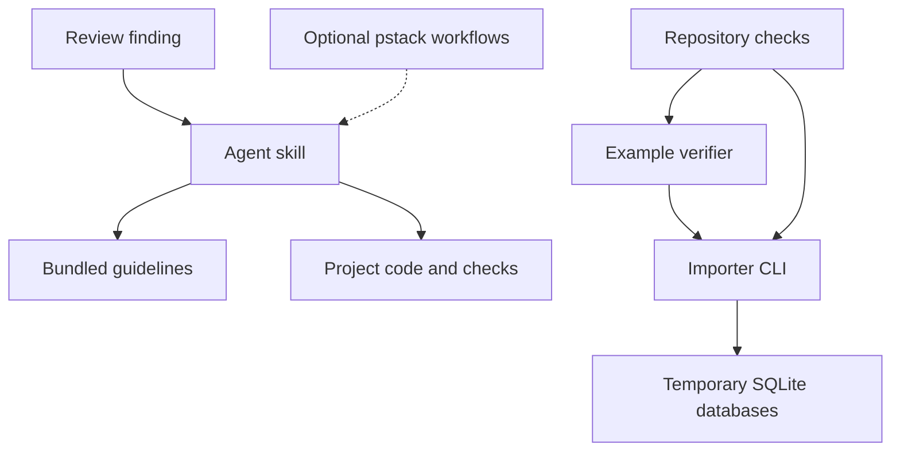

# Architecture

The skill, demo, and repository checks each have their own entry point. The skill ships with its guidelines so it can be installed from its folder alone. The demo can be run directly from a checkout with Python.

| Component | Entry point | Responsibility |
| --- | --- | --- |
| Agent workflow | [SKILL.md](../skills/slop-to-gold-engineering/SKILL.md) | Guide the agent from a recurring review finding to a reproducible check in the user's repository. |
| Engineering guidelines | [Bundled reference](../skills/slop-to-gold-engineering/references/engineering-standard.md) | Explain how to choose a constraint, collect evidence, and use optional pstack workflows. |
| Example application | [importer.py](../examples/importer.py) | Expose import and list commands backed by SQLite. Keep the faulty and corrected implementations available as separate demo modes. |
| Example driver | [verify.py](../examples/verify.py) | Run both modes through the CLI with separate temporary databases and compare the saved IDs. |
| Repository checks | [Tests](../tests/) and [CI workflow](../.github/workflows/verify.yml) | Check the documented output, the baseline diagnostic, and overlapping replay requests. |



## Verification boundaries

The example demonstrates single-record replay handling, including concurrent clients after schema setup. The fixture uses separate databases for the two modes. The checks cover the local CLI with synthetic data. Database migrations and network retries need their own checks in a production importer.

Run the same checks used by CI from the repository root:

```sh
python3 examples/verify.py
python3 -m unittest discover -s tests
```
